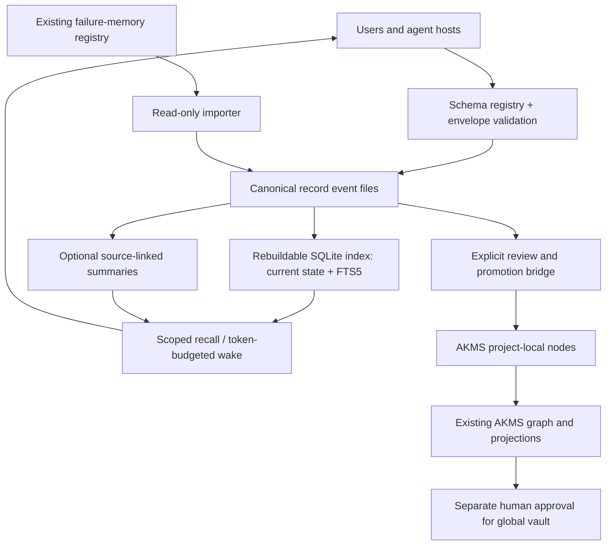

# ADR 0002 — Extensible records, episodic memory, and selective knowledge promotion

**Status**: accepted (2026-11-05)

**Scope**: AKMS ecosystem; new optional `akms-records` package

**Related**: [ADR 0001 — Projection and evidence contract surface](0001-projection-and-evidence-contract-surface.md)

## Context

AKMS compiles typed knowledge nodes into a global/local graph, produces
deterministic task-scoped projections, and ingests structured evidence. Its
global vault is read-only to automated workflows; a project-local overlay owns
mutable experience and proposals. The public projection and evidence contracts
are runtime-independent ([ADR 0001](0001-projection-and-evidence-contract-surface.md)).

The independently installable `akms-failure-memory` package provides useful
building blocks: canonical project-owned history, stable identifiers,
validation, deterministic compilation, locking, generated AKMS nodes and routes,
and no automatic global-vault promotion. It is **not** a generic memory
service. Its recorder and compiler require failure-oriented fields (`symptom`,
`root_cause`, `fix`, `prevention`, repository location, discovery and fix
dates), generate path-based routes, and mark compiled lessons as established
with high confidence. These assumptions cannot safely be applied to arbitrary
agent-generated experiences or scientific claims.

Agent hosts need to retain decisions, investigations, preferences, failed *and
successful* approaches, observations, and ideas. AKMS users should be able to
define their own record schemas without modifying AKMS source code. A useful
memory service must also support inexpensive writes, fast retrieval, bounded
startup context, durable provenance, and optional compression. Compiling every
experience into a full knowledge graph is too costly and semantically
misleading. [OptMem](https://github.com/VictorTaelin/OptMem) demonstrates the
value of a small persistent log and hierarchical summaries, but it does not
provide the typed evidence and knowledge contracts sought here.

The AKMS v2 node models are frozen: changing them requires a schema version
bump and migration. This ADR does not change them.

## Decision

**Introduce `akms-records` as an optional, independently installable AKMS
ecosystem package.** It provides a schema-driven, provenance-aware record store
and an episodic-memory service. It integrates with existing AKMS contracts
through a separate, selective promotion adapter. It does **not** redefine AKMS
knowledge nodes, and AKMS core does not depend on it.

1. **Open payload, fixed envelope.** Users register versioned JSON Schemas for
   arbitrary record payloads. A small AKMS-controlled envelope defines stable
   identity, schema reference and digest, scope, timestamps, origin, source
   references, summary, tags, sensitivity, review state, lifecycle state, and
   revision. User schemas cannot override these invariants.
2. **Event history is canonical; retrieval artifacts are derived.** Normal
   changes append `create`, `amend`, `supersede`, or `retract` events instead
   of editing prior records. Stable record IDs and revision preconditions
   protect concurrent updates. The current-state view, search index,
   summaries, and graph nodes are rebuildable projections. Privacy erasure is a
   separately audited exception to append-only retention; a tombstone alone is
   insufficient.
3. **Cheap recall before graph compilation.** Structured lookup, scoped recall,
   and token-budgeted `wake` operate on the record store and its index without
   rebuilding the AKMS graph or calling an LLM.
4. **Compaction is optional and keeps its sources.** Topical or hierarchical
   summaries may be built from records, but each assertion links to the record
   IDs and revisions it came from. Corrections invalidate affected summaries.
   Full history stays available unless an explicit retention or erasure policy
   removes it.
5. **Knowledge promotion is explicit, and its policy is set per schema.**
   A reviewed record may be projected into a valid AKMS **project-local** node.
   A person may set a promotion policy for any registered schema, and change it
   later, without changing the schema (see [Promotion](#promotion)). Without
   one, promoted nodes are `source: agent`, `status: tentative`. Agent-authored local nodes are never converted to
   `established`. Promotion to the curated global vault always requires a
   separate human-approved action outside this package.
6. **Compatibility precedes refactoring.** `akms-failure-memory` keeps its CLI,
   registry, stable IDs, behavior, and generated outputs. A read-only importer
   proves parity before any shared internals move. Existing failure lessons are
   never migrated or reinterpreted implicitly.
7. **Host neutrality.** The package exposes a Python API and its own
   `akms-records` CLI, with an optional MCP or skill adapter later. It does not
   require a particular agent host, OptMem, an LLM provider, an orchestration
   runtime, or a network service. It depends on `akms` only through an optional
   extra used by the promotion bridge.

## Architecture and ownership



**Canonical authority.** The records store owns event history and custom
payloads; AKMS graph nodes remain derived knowledge projections. A repository,
ADR, or operational system stays authoritative for its own *current* decisions
or state: memory preserves sourced observations and decision history, but does
not supersede ADRs, task trackers, or other source systems.

**Storage.** Canonical records are plain files with one directory per record
and one immutable event file per revision, chained by the hash of the previous
revision. A revision is written to a temporary file and then linked into
place, and the link fails if that revision already exists. That exclusive step
is the concurrency check, so writers need no shared lock, and readers never see
a partial event. Record IDs carry enough randomness (eight base32 characters
after the date) that separate clones do not collide, and a retried create with
the same event ID is a no-op. Event files are marked binary-safe for git (no
line-ending conversion), and the erasure log merges by union. Parallel work on
separate records therefore merges in git without textual conflicts, and a
conflict appears only when the same record is changed on two branches. A derived SQLite database (FTS5 plus indexed metadata) is the query
layer. It is never committed, can always be rebuilt from the event files, and
belongs to one working tree: after a checkout or merge it is reconciled with
the files on disk.
A portable JSONL export and import is mandatory. Embeddings are opt-in, and
only after evidence that structured and lexical recall are inadequate. A cloud
sync folder or shared document is not a transactional store.

| Scope | Canonical location | Index |
|---|---|---|
| `project` | `<repo>/.knowledge/records/`, version-controlled with the project | `<repo>/.knowledge/records/.index/`, ignored by git |
| `agent`, `shared` | `~/.knowledge/records/<kind>/<id>/`, overridable by `AKMS_RECORDS_HOME` | under the same root, `.index/` |

A repository that still uses the older `knowledge/` directory keeps its records
under `knowledge/records/`.

**Scope and access.** Records belong to explicit `agent`, `project`, or
`shared` namespaces. The API enforces visibility: an agent's `wake` and
`recall` never return another agent's records or records above its sensitivity
allowance. This isolation is a policy for cooperating agents, not a security
boundary. Any local process that can read the store directory can read every
record in it, so agents that must not see each other's records need separate
store roots with operating-system permissions. Sensitive records are excluded
from routine cross-agent retrieval and from exports by default.

## Record and schema contract

A record is a **typed experience or observation**, not automatically a fact.
An example record:

```json
{
  "record_id": "rec-20261102-k3f9m2xa",
  "revision": 1,
  "schema_ref": "research-decision/v1",
  "schema_sha256": "<digest recorded at registration>",
  "scope": {"kind": "project", "id": "example"},
  "recorded_at": "2026-11-02T16:00:00Z",
  "origin": {"kind": "human-confirmed", "actor_id": "principal"},
  "source_refs": [{"kind": "decision-log", "ref": "decision-2026-10-10"}],
  "summary": "Retain and retrain the existing surrogate architecture",
  "tags": ["surrogate", "model-direction"],
  "sensitivity": "internal",
  "review_state": "user_confirmed",
  "lifecycle": "active",
  "payload": {
    "decision": "Retrain the existing surrogate instead of introducing a new one",
    "alternatives": ["Introduce a new surrogate"],
    "rationale": "Preserve the established model direction",
    "revisit_when": "New validation evidence changes the trade-off"
  }
}
```

`schema_ref` names a locally registered JSON Schema (Draft 2020-12). The
registry stores the digest of the schema's canonical JSON at registration,
every record carries that digest, and a schema whose content no longer matches
is refused (formatting-only edits keep the digest).
Schemas support required fields, types, enums, nested objects, and references
to local `$defs`. Remote `$ref` resolution (including `file:` references) and
executable validation hooks are refused, checked by a static scan at
registration as well as at validation time. The `format` keyword is an
annotation only, so a record validates the same way on every machine. A change requires a new schema version and an explicit, testable
migration; historical records keep their original schema and meaning.

A schema registration also declares, **declaratively**, extraction rules for
searchable text, display label, time fields, optional relationships, and the
recall summary. Registration may not run user-supplied Python or shell commands. Missing or
invalid source references stay visible rather than being upgraded into
verified evidence.

Built-in schema templates are shipped as plain schema files: `decision`,
`experiment-observation`, `research-finding`, `idea`, `preference`,
`successful-approach`, `failed-approach`, and `workflow-lesson`. They are
examples, not privileged types.

## Read, write, and promotion semantics

- **Remember:** validate schema and envelope, allocate an ID, commit the event
  atomically, and update the derived index. The write path never calls an LLM
  or rebuilds the AKMS graph.
- **Recall:** filter by visibility, scope, schema, tags, time, and keywords;
  rank current-state records; show their summaries and provenance; return full
  records on demand.
- **Wake:** given an agent, a task description, and a hard token limit, return
  prioritized, deduplicated records and summaries with stable identifiers and a
  truncation report. Review state decides what is eligible and which tier a record
  is in (reviewed above unreviewed); within a tier, task match decides the order,
  because a wake's job is what this task needs, and an evaluation showed a store's
  `user_confirmed` records otherwise fill the budget regardless of the task. Token counts use the AKMS loadout estimator, so a record
  budget and a loadout budget mean the same thing. It never includes another
  agent's private records. It reads only the record store. Promoted records and
  imported failure lessons are left out by default, because the loadout and
  failure-memory already serve them, and a caller can ask for them deliberately. A
  reviewed record superseded by a successor nobody has reviewed stays, marked with the
  successor, so one agent's unchecked replacement cannot make a checked fact vanish.
- **Rendering is data, not instructions.** Recall and wake output render record
  text as quoted data in a fixed layout, with origin and review state shown, so
  text inside a record cannot pose as instructions or forge a section boundary.
- **Consolidate:** optionally produce topical or hierarchical summaries that
  reference their source records and carry deterministic invalidation
  metadata. The default is extractive and uses no LLM; an explicitly selected
  provider is recorded with its input versions. Raw history and summaries stay
  distinct.
- **Reviews apply to text:** an agent's change to a record's payload, summary or
  origin makes a reviewed record `unreviewed`, and it cannot name `user_confirmed` in
  the same amend. The person a record belongs to keeps its state.
- **Correct or forget:** append correction, supersession, or retraction events
  for normal history. A separately authorized erasure removes protected content
  from the canonical files, the index, summaries, and exports under the
  package's control, and reports what it cannot reach. For project-scope records
  already committed and pushed, erasure from git history needs a history
  rewrite outside AKMS. Other clones and unmerged branches may still hold the
  record, and a later merge can bring back an amendment made before the
  erasure; the store's consistency check re-applies logged erasures. The
  erasure report names what it could not reach.

### Promotion

Promotion requires review evidence and publishes only to the project-local
overlay. It never writes the global vault.

- **Default (no policy declared):** the bridge passes the record to the AKMS
  evidence contract, `update_graph` with `NewKnowledge`. The node is created as
  `source: agent`, `status: tentative`, or a similar tentative node is extended
  by `update_graph`'s deduplication.
- **Schema policy:** a person may give a registered schema a promotion policy
  of `source: human` with `status: tentative` or `status: established` and a
  confidence value. The policy is stored beside the schema, not inside it, so
  setting or changing it never requires a new schema version and never
  changes existing records. Every change is appended to a policy log with the
  actor, time, and previous value. Under such a policy the node is written as
  a validated `LocalNodeFrontmatter` file, the same as a person authoring it,
  and only when the record's review state is human-confirmed and the promote
  command carries an explicit human approval. Writing it also needs confirmation:
  an interactive terminal that shows what will be written, or an explicit `--yes`.
  Without either it is refused, and it never falls back to the default path. The
  Python API defaults to not confirmed. `--yes` makes the step deliberate; it does
  not prove a person took it.
- **Who may set a policy:** `schema policy set` is a human operation. It asks
  for interactive confirmation and is not exposed through the agent-facing API
  or the MCP adapter. As with scope isolation, this is a policy for cooperating
  agents: a process that can run the CLI on a terminal could also run it, which
  is why every change is logged.
- **Never:** an agent-sourced node is never `established`; record creation alone
  never raises status or confidence; provenance is never synthesized.
- The v2 node models have no field for a record ID, so the node body carries a
  Sources section listing the record ID and revision. The record names its node
  with an amend event that adds a reserved `promoted-to` source reference, so the
  event format and the envelope stay as they are.

Records that describe a single attempt should usually stay records rather than
become general knowledge claims.

The CLI (experimental, so names may still change):

```bash
akms-records schema register ./research-decision.schema.json --scope project:example
akms-records schema policy set research-decision --scope project:example --source human --status established --confidence 0.8
akms-records add --schema research-decision/v1 --scope project:example --file decision.json
akms-records recall --scope project:example --query "surrogate" --limit 20
akms-records wake --agent scout --task "review model directions" --budget-tokens 1200 --scope project:example
akms-records consolidate create --scope project:example --tag surrogate
akms-records promote rec-20261102-k3f9m2xa --scope project:example --review approved
akms-records import --scope project:example --from-failure-memory .knowledge/failure-memory.toml
```

## Relationship to `akms-failure-memory`

`akms-failure-memory` is a specialized, project-owned workflow with a compiler,
route generation, fingerprints, refresh coordination, and existing consumers.
It is not renamed or removed. `akms-records` is built **alongside** it and
reuses its patterns (dated IDs, locking, atomic replace) without importing it.
Shared validation, recording, locking, and indexing code may be factored out
later, and only after equivalence tests prove that existing registries, routes,
IDs, manifests, and public behavior are unchanged. The failure-memory
compiler's high-confidence `established` convention is **not** the default for
user-defined schemas.

## Alternatives considered

| Alternative | Decision | Reason |
|---|---|---|
| Use OptMem unchanged | Not selected as the foundation | Efficient episodic-memory approach, but no AKMS typed evidence or projection contract; kept as an evaluation baseline. Its source is not copied. |
| Encode every memory as an AKMS node | Rejected | Excessive indexing and compilation, conflation of experience with established knowledge, larger prompt context. |
| Generalize the failure-only registry in place | Rejected for the first release | Breaks existing strict field contracts, path routing, output semantics, and user data compatibility. |
| Add arbitrary record fields to the AKMS v2 models | Rejected | The models are frozen; unnecessary migration and coupling. |
| Make the record service an AKMS core dependency, or an `akms records` subcommand | Rejected | Violates the runtime-independent contract principle of ADR 0001; core has no plugin mechanism. |
| One canonical SQLite file or one JSONL ledger per scope | Rejected for project scope | Neither merges in git: a binary database cannot, and one append-only file conflicts on every parallel append. |
| Store canonical records in a cloud sync folder | Rejected | Sync semantics are not a reliable multi-writer transactional store. |
| Make vector embeddings mandatory | Rejected | Extra dependencies and cost without demonstrated benefit over metadata, full text, and summaries. |

## Consequences

**Positive:** more domains can adopt AKMS without custom code; agents retain
experiences without graph rebuilds; users author their own schemas; knowledge
promotion stays reviewable; existing AKMS contracts are preserved; retrieval can
be benchmarked against OptMem.

**Costs and risks:** an additional package and persistence layer; schema
lifecycle and migration tooling; irrelevant or outdated memories entering
context; concurrent-write and crash-recovery complexity; compaction can omit
nuance; privacy erasure conflicts with append-only retention and cannot reach
pushed git history. Mitigations: scoped access, versioned schemas and events,
rebuildable projections, source-linked summaries, explicit promotion, recovery
tests, and a documented erasure procedure.

## Implementation phases and gates

| Phase | Deliverable | Exit gate |
|---|---|---|
| 0. Contract spike | Event-file format, locking, crash recovery, two-process writes, two-branch merge, FTS5 on all CI platforms, erasure | Written storage confirmation; ADR unchanged unless an invariant must change |
| 1. Records MVP | Schema registry with digests, create/amend/supersede/retract, validators, stable IDs, export/import | Deterministic replay; no silent data loss; scope tests |
| 2. Fast recall | Rebuildable SQLite FTS5 index, scoped recall, budgeted `wake` | Correct isolation, stable provenance, rebuild parity |
| 3. Consolidation | Optional source-linked summaries, invalidation | No unsupported claim added by compaction; source trace intact |
| 4. AKMS bridge | Project-local promotion (default and per-schema policy) and failure-memory importer | Installed-minimal-package integration; v2 schemas unchanged; no global write |
| 5. Evaluation | Comparative benchmark, usage docs, host-agent pilot | Meets baseline quality, latency, and token-budget criteria; no regressions |

### Acceptance tests and performance policy

1. **Retrieval quality:** a labelled recall set across decisions, lessons,
   preferences, experiments, and research notes; precision, recall,
   stale-memory errors, and unsupported assertions, compared with OptMem and a
   plain file-search baseline on the **same corpus and hardware**. No
   replacement claim until quality is comparable or better for the intended
   workloads.
2. **Efficiency:** ingestion latency, p50/p95 scoped recall latency, cold
   `wake` cost, memory and disk overhead, and tokens per returned useful fact at
   increasing corpus sizes. Numerical thresholds are set after the Phase 0
   reference benchmark.
3. **Determinism:** replaying canonical events into a clean store reconstructs
   identical current-state records and indexes; re-indexing never changes
   source records or knowledge state.
4. **Safety:** unauthorized scope access, tampered schemas, remote `$ref`,
   duplicate events, stale revision writes, and interrupted writes all fail
   without changing stored data. Records containing instruction-like text are
   rendered as quoted data and never alter the output layout.
5. **Compatibility:** existing `akms-failure-memory` fixtures and the
   installed-wheel external-consumer tests keep passing without importing
   `akms.orchestrator` or `akms.agents`; existing IDs and outputs are not
   transformed.
6. **Promotion discipline:** agent-sourced local nodes cannot bypass
   `tentative`; a human schema policy applies only to human-confirmed records
   with explicit approval, and every policy change is in the policy log; no global-vault writes, no synthetic provenance, and
   no confidence inflation from record creation alone.
7. **Deletion:** an erasure test verifies removal from canonical files, the
   index, and summaries, and checks that the report names what it could not
   reach (backups, exported copies, pushed git history).

## Open questions

These are implementation choices, not blockers:

- Default scope hierarchy and cross-project sharing approvals for several
  agents on one machine.
- Whether full-text retrieval covers the target corpus, or optional semantic
  retrieval materially improves it.
- Compaction trigger policy (cadence, growth threshold, or token pressure); the
  default is conservative and opt-in.
- Retention and backup-erasure policy, including limits imposed by hosted agent
  platforms outside AKMS's control.
- Which CLI operations stay provisional in the first experimental release.

**Decision state:** accepted. `akms-records` implements the contract spike, the
records store, recall and wake, consolidation, the promotion bridge and the importer
as an experimental package. The evaluation phase and its acceptance tests for
retrieval quality and efficiency are still open.
